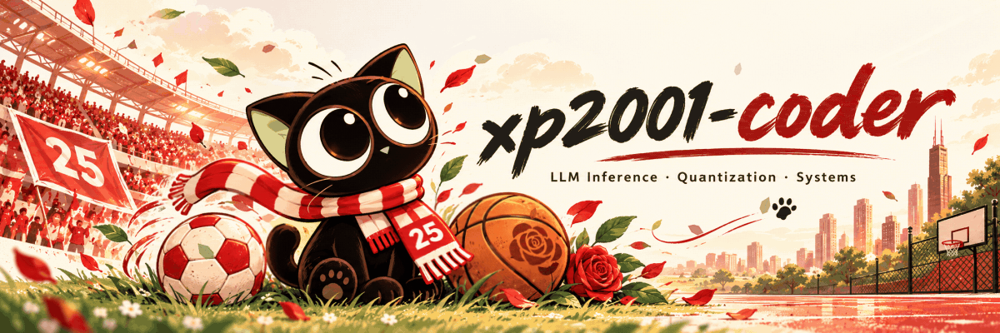

  

I work on AI infrastructure, model quantization, inference performance, and distributed LLM systems.

### Selected Work

- **Model Quantization** — Research and tooling · [LLMC](https://github.com/ModelTC/LightCompress) · [MQBench](https://github.com/ModelTC/MQBench) · [PPQ](https://github.com/OpenPPL/ppq)
- **LLM Inference & GPU Kernels** — Runtime performance and MACA backend work · `C++ / Python / CUDA / MACA` · [vLLM](https://github.com/xp2001-coder/vllm) · [SGLang](https://github.com/xp2001-coder/sglang) · [llama.cpp](https://github.com/xp2001-coder/llama.cpp)
- **Distributed Inference** — KV-cache transport and distributed serving · [Mooncake](https://github.com/xp2001-coder/Mooncake)
- **Learning Notes** — [zero2vllm](https://github.com/xp2001-coder/zero2vllm) · Inference systems from first principles.
